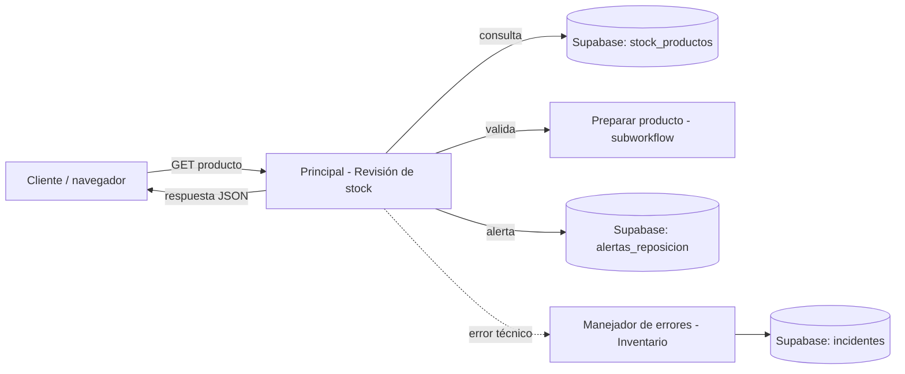

# Inventario: revisión de stock y alertas de reposición

Automatización en n8n que, al recibir el nombre de un producto, consulta su stock en Supabase, decide si hay que reponerlo, registra una alerta sin duplicarla y guarda como incidente cualquier fallo técnico.

**Curso:** Automatización inteligente de procesos con n8n · EAM · 2026 II · Segundo corte

## Integrantes

| Integrante | Responsabilidad |
|---|---|
| `Jorge Martinez` | `workflow principal` |
| `Gabriela Rios` | `subworkflow y validaciones` |
| `Michael Aguilera` | `Supabase, manejador de errores` |
| `Valentiha Gutierrez` | `Webhook y pruebas` |

## Problema que resuelve

Revisar a mano si un producto está por debajo de su stock mínimo es lento, propenso a errores y no deja registro. Esta solución automatiza la revisión, calcula el faltante, asigna una prioridad y guarda la alerta.

## Alcance actual

**Disponible**
- Webhook `GET /revisar-stock?producto=...`.
- Lectura y escritura en Supabase mediante HTTP Request.
- Subworkflow de limpieza y validación de datos.
- Prioridades Alta, Mediana y Baja, con cálculo del faltante.
- Alertas sin duplicados (una por producto y día).
- Reintentos (3 × 2 s) y manejador de errores que guarda incidentes.

**Limitaciones principales**
- No envía notificaciones; solo guarda registros.
- No actualiza el stock ni genera órdenes de compra.
- Si falta el parámetro `producto`, la búsqueda coincide con todos los productos.
- RLS deshabilitada en el entorno de pruebas.

## Arquitectura



| Workflow | Archivo | Responsabilidad |
|---|---|---|
| Principal - Revisión de stock | [`workflows/Principal_Revision_Stock.json`](workflows/Principal_Revision_Stock.json) | Webhook, consulta, decisión, registro de alerta y respuesta |
| Preparar producto | [`workflows/Preparar_Producto.json`](workflows/Preparar_Producto.json) | Limpia y valida `id`, `producto`, `stock` y `stock_minimo` |
| Manejador de errores - Inventario | [`workflows/Manejador_Errores.json`](workflows/Manejador_Errores.json) | Guarda en `incidentes` los fallos de ejecuciones automáticas del principal |

## Requisitos

- n8n.
- Cuenta de Supabase (plan gratuito sirve) y un proyecto propio.
- Credencial **Supabase API** en n8n con la URL del proyecto y la clave `service_role`.
- Navegador o herramienta para peticiones GET.

## Configuración

1. En Supabase, abrir **SQL Editor → New query**, pegar [`workflows/Preparar_Supabase.sql`](workflows/Preparar_Supabase.sql) y ejecutar. Crea `stock_productos`, `alertas_reposicion` e `incidentes` y carga cinco productos ficticios.
2. En n8n, crear la credencial **Supabase API** con los datos de **su propio** proyecto. No compartan ni suban esos valores.


## Importación y conexiones

Importar en este orden (*Workflows → Import from file*):

1. `Preparar_Producto.json`
2. `Manejador_Errores.json`
3. `Principal_Revision_Stock.json`

Después de importar:

- En los nodos `HTTP Request`, `Registrar alerta en Supabase` y `Registrar incidente en Supabase`: reemplazar `TU-PROYECTO` en la URL por su proyecto y seleccionar su credencial.
- En `Preparar producto (subworkflow)`: seleccionar el workflow **Preparar producto** (el identificador no viaja en el JSON).
- En el principal: *Settings → Error workflow* → **Manejador de errores - Inventario** (esta asociación tampoco viaja en el JSON).
- Publicar en este orden: subworkflow, manejador y principal. n8n no deja asociar ni publicar si el destino no está publicado.

## Ejecución

**Pruebas (manual):** abrir el principal, pulsar *Listen for test event* en el nodo Webhook y abrir
`http://localhost:5678/webhook-test/revisar-stock?producto=Peluche%20Stitch`.
La URL de prueba solo responde una vez por cada *Listen*. El Manual Trigger usa el dato fijado `{query: {producto: "Peluche Stitch"}}`.

**Funcionamiento habitual (producción):** con los tres workflows publicados, llamar
`http://localhost:5678/webhook/revisar-stock?producto=<nombre>`.
n8n debe estar en ejecución. Solo las ejecuciones automáticas activan el manejador de errores y se consultan en la pestaña *Executions*.

No hay programación automática. Para detener el flujo, despublicar el principal.

## Prueba de ejemplo

Con los datos del script SQL:

1. Petición: `GET /webhook-test/revisar-stock?producto=Peluche Stitch` (stock 3, mínimo 10).
2. Salida esperada (campos principales):

```json
[{
  "alerta_id": "1-2026-10-24",
  "producto": "Peluche Stitch",
  "stock": 3,
  "stock_minimo": 10,
  "faltante": 7,
  "prioridad": "Alta",
  "estado_stock": "Stock crítico",
  "accion": "Reponer inmediatamente",
  "estado_atencion": "pendiente",
  "alerta_registrada": true
}]
```

3. En Supabase, `alertas_reposicion` contiene una fila para el producto. Repetir la petición el mismo día no crea otra. La parte numérica de `alerta_id` es el `id` del producto en su propia tabla y la fecha es la del día de la prueba.

Otros casos: `Peluche Mickey` (Mediana), `Camiseta Roja` (sin alerta), `zzzz` (no encontrado), `Sin Stock` (datos no válidos).

## Documentación y evidencias

- [Bitácora unificada](documentacion/Bitacora_Unificada_Proyecto.md)
- [Presentación del proyecto ](documentacion/Presentacion_Corte_2.pdf)
- [Diagrama del proceso manual](documentacion/diagramas/Proceso_Manual.png)
- [Diagrama del proceso automatizado](documentacion/diagramas/Proceso_Automatizado.png)
- [Evidencias de pruebas (PDF)](documentacion/evidencias/Evidencias_Pruebas_Inventario.pdf)


## Estructura del repositorio

```text
Inventario_Revision_Stock/
├── README.md
├── workflows/
│   ├── Principal_Revision_Stock.json
│   ├── Preparar_Producto.json
│   ├── Manejador_Errores.json
│   └── Preparar_Supabase.sql
└── documentacion/
    ├── Bitacora_Unificada_Proyecto.md
    ├── Presentacion_Corte_2.pdf
    ├── diagramas/
    └── evidencias/
```

## Seguridad

Todos los datos son ficticios. El repositorio no contiene claves ni credenciales; 
