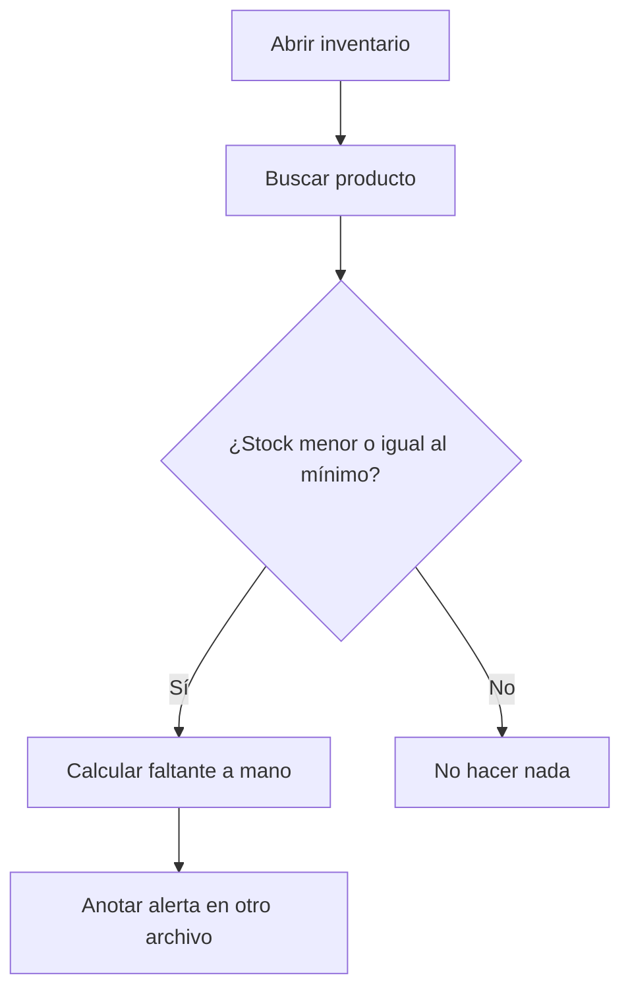
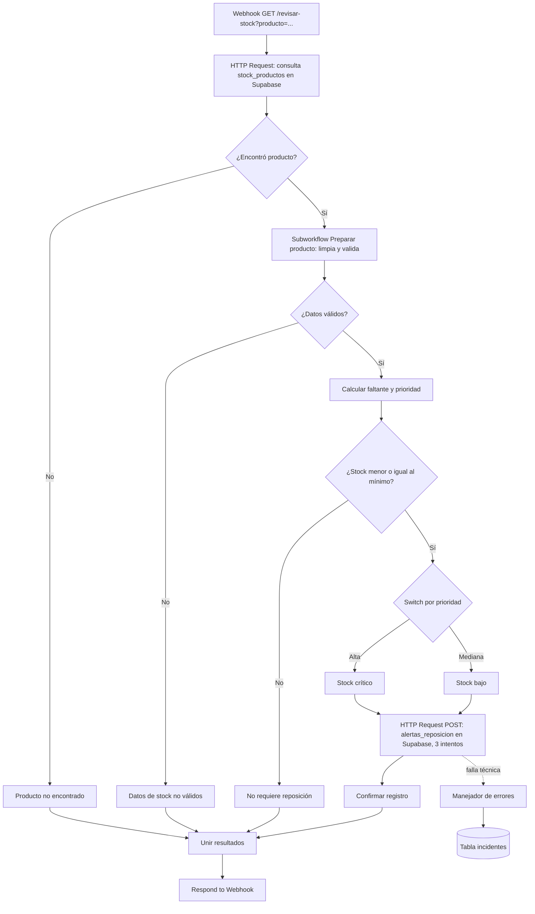

# Bitácora unificada: Inventario, revisión de stock y alertas de reposición

**Curso:** Automatización inteligente de procesos con n8n · EAM · 2026 II
**Corte:** Segundo corte
**Fecha de actualización:** 25 de octubre de 2026
**Versión del proyecto:** corresponde a los JSON de la carpeta `workflows/` y a las pruebas del 24 de octubre de 2026.


---

## 1. Identificación y alcance

### 1.1 Proyecto e integrantes

| Integrante | Responsabilidad |
|---|---|
| `Jorge Martinez` | `workflow principal` |
| `Gabriela Rios` | `subworkflow y validaciones` |
| `Michael Aguilera` | `Supabase, manejador de errores` |
| `Valentiha Gutierrez` | `Webhook y pruebas` |

### 1.2 Problema y objetivo

Quien administra una tienda necesita saber qué productos están por debajo de su stock mínimo para reponerlos a tiempo. Revisar producto por producto en la base de inventario es lento y es fácil olvidar un faltante o no dejar rastro de que se detectó.

**Objetivo de la automatización:** al consultar un producto por nombre, el sistema decide si requiere reposición, calcula cuánto falta, asigna una prioridad, deja registrada una alerta (sin duplicarla) y responde con el resultado. Si algo falla técnicamente, el fallo queda guardado como incidente.

### 1.3 Qué incluye esta versión

- Consulta de un producto por nombre mediante un Webhook (`GET /revisar-stock?producto=...`).
- Lectura del inventario en Supabase (HTTP Request).
- Subworkflow que limpia y valida los datos.
- Reglas de prioridad (Alta, Mediana, Baja) y cálculo del faltante.
- Registro de alertas en Supabase sin duplicados.
- Reintentos y manejador de errores que guarda incidentes en Supabase.

### 1.4 Qué queda por fuera

- No se envían notificaciones (correo, chat). Solo se guardan registros.
- No se actualiza el stock ni se generan órdenes de compra.
- No hay revisión masiva programada de todo el inventario.
- No hay interfaz de usuario: se usa el navegador o una herramienta de peticiones HTTP.
- No se incorpora inteligencia artificial.

---

## 2. Proceso manual y proceso automatizado

### 2.1 Proceso manual

1. La persona abre la hoja o la base de inventario.
2. Busca el producto y compara a ojo el stock con el mínimo.
3. Decide si hay que reponer y cuánto falta.
4. Anota (o no) la alerta en otro lugar.

**Dificultades:** tarea repetitiva, comparaciones propensas a error, datos incompletos que pasan inadvertidos, alertas olvidadas o repetidas, y ningún registro de cuándo se detectó el faltante.



### 2.2 Proceso automatizado con n8n




---

## 3. Funcionamiento de la solución

### 3.1 Recorrido de una solicitud

1. **Activación.** Una petición GET llega al Webhook con el parámetro `producto`. Para pruebas manuales también existe un Manual Trigger con un dato fijado (`{query: {producto: "Peluche Stitch"}}`).
2. **Consulta.** El nodo `HTTP Request` busca en `stock_productos` los nombres que contienen el texto recibido, sin distinguir mayúsculas.
3. **Existencia.** `¿Encontró producto?` comprueba si la respuesta trae un `id`. Si no, devuelve «Producto no encontrado».
4. **Validación.** El subworkflow `Preparar producto` recibe `id`, `producto`, `stock` y `stock_minimo`, limpia los datos y devuelve `datos_validos`.
5. **Decisión.** Si los datos no son válidos, responde «Datos de stock no válidos». Si lo son, calcula el faltante y la prioridad.
6. **Reglas de reposición.** Stock menor o igual al mínimo → alerta; mayor → «No requiere reposición».
7. **Registro.** Las rutas Alta y Mediana escriben la alerta en `alertas_reposicion`.
8. **Respuesta.** `Unir resultados` reúne el resultado de la ruta tomada y `Respond to Webhook` lo devuelve con código 200.

### 3.2 Campos

| Campo | Origen | Obligatorio | Uso |
|---|---|---|---|
| `producto` (query) | Webhook | Sí, para obtener un resultado útil | Texto de búsqueda |
| `id` | `stock_productos` | Sí | Clave de la alerta |
| `producto` | `stock_productos` | Sí (no vacío) | Nombre y mensaje |
| `stock` | `stock_productos` | Sí (número ≥ 0) | Comparación y faltante |
| `stock_minimo` | `stock_productos` | Sí (número ≥ 0) | Comparación y faltante |

### 3.3 Reglas de decisión

| Condición | Estado devuelto | Acción | ¿Escribe en Supabase? |
|---|---|---|---|
| No hay coincidencias | Producto no encontrado | Revise el nombre del producto | No |
| `producto` vacío, `stock` o `stock_minimo` vacío, no numérico o negativo | Datos de stock no válidos | Corregir el registro en inventario | No |
| `stock < stock_minimo` | Stock crítico (prioridad Alta) | Reponer inmediatamente | Sí, alerta |
| `stock = stock_minimo` | Stock bajo (prioridad Mediana) | Reponer pronto | Sí, alerta |
| `stock > stock_minimo` | Stock suficiente (prioridad Baja) | No requiere reposición | No |

### 3.4 Responsabilidad de cada workflow

| Workflow | Archivo | Responsabilidad | Recibe | Devuelve |
|---|---|---|---|---|
| Principal - Revisión de stock | `Principal_Revision_Stock.json` | Webhook, consulta, decisión, registro de alerta y respuesta | Petición HTTP con `producto` | Lista JSON con el resultado |
| Preparar producto | `Preparar_Producto.json` | Limpiar y validar un producto | `id`, `producto`, `stock`, `stock_minimo` | Los mismos campos normalizados más `datos_validos` y `motivo` |
| Manejador de errores - Inventario | `Manejador_Errores.json` | Guardar un incidente cuando falla una ejecución automática del principal | Evento del Error Trigger | Fila en `incidentes` |

### 3.5 Expresiones importantes

**Búsqueda parcial del producto** (`HTTP Request`, parámetro `producto`):

```
=ilike.*{{ $json.query?.producto || '' }}*
```
Convierte el texto recibido en un filtro de Supabase que ignora mayúsculas y acepta coincidencias parciales.
Entrada: `query.producto = "stitch"` → filtro `ilike.*stitch*` → devuelve «Peluche Stitch».

**Limpieza del nombre** (subworkflow, `Normalizar datos`):

```
={{ String($json.producto).trim() }}
```
Entrada `"  Peluche Stitch "` → salida `"Peluche Stitch"`.

**Conversión a número** (`Number($json.stock)`): entrada `"3"` → salida `3`.

**Motivo de rechazo** (subworkflow, `Marcar datos no válidos`): arma una lista con los campos que fallan y la une con `; `.
Entrada `stock = null`, `stock_minimo = 5` → salida `motivo = "stock no válido"`.

**Faltante** (`Transformar y calcular`):

```
={{ Math.max(0, $json.stock_minimo - $json.stock) }}
```
Entrada `stock 3, mínimo 10` → `faltante 7`. Entrada `stock 10, mínimo 10` → `faltante 0`.

**Prioridad** (`Asignar prioridad`):

```
={{ $json.stock < $json.stock_minimo ? 'Alta' : $json.stock == $json.stock_minimo ? 'Mediana' : 'Baja' }}
```
Entrada `3 / 10` → `Alta`; `10 / 10` → `Mediana`; `50 / 10` → `Baja`.

**Clave anti-duplicados** (`Registrar alerta en Supabase`):

```
={{ $json.id }}-{{ $now.toFormat('yyyy-MM-dd') }}
```
Entrada `id 1` el 24/10/2026 → `alerta_id = "1-2026-10-24"`. Repetir la petición el mismo día genera la misma clave.

**Confirmación de la alerta** (`Confirmar registro`):

```
={{ $json.alerta_id !== undefined }}
```
Solo es `true` si Supabase devolvió la fila con su `alerta_id`; no basta con haber enviado la petición.

**Identificador del incidente** (manejador): `String($json.execution?.id ?? $now.toMillis())`. Entrada: ejecución 230 → `ejecucion_id = "230"`.

### 3.6 Dónde se consulta, crea o actualiza

| Operación | Recurso | Nodo |
|---|---|---|
| Lee | `stock_productos` | `HTTP Request` |
| Crea o actualiza | `alertas_reposicion` | `Registrar alerta en Supabase` |
| Crea o actualiza | `incidentes` | `Registrar incidente en Supabase` (manejador) |

---

## 4. Integraciones y configuración

### 4.1 Servicios externos

| Servicio | Función |
|---|---|
| Supabase (API REST/PostgREST) | Base de datos de inventario, alertas e incidentes |
| n8n | Orquestación, Webhook, subworkflow y manejador de errores |

### 4.2 Llamadas con HTTP Request

| Nodo | Método | Endpoint (sin secretos) | Parámetros / campos | Respuesta relevante |
|---|---|---|---|---|
| `HTTP Request` | GET | `https://uwbwyaudihyhjaoybwdk.supabase.co/rest/v1/stock_productos` | Query `producto=ilike.*texto*` | Lista de filas con `id`, `producto`, `stock`, `stock_minimo` |
| `Registrar alerta en Supabase` | POST | `https://uwbwyaudihyhjaoybwdk.supabase.co/rest/v1/alertas_reposicion` | Query `on_conflict=alerta_id`; encabezado `Prefer: resolution=merge-duplicates,return=representation`; cuerpo con `alerta_id`, `producto`, `stock`, `stock_minimo`, `faltante`, `prioridad`, `estado_stock`, `accion`, `mensaje` | Fila creada o actualizada |
| `Registrar incidente en Supabase` | POST | `https://uwbwyaudihyhjaoybwdk.supabase.co/rest/v1/incidentes` | Query `on_conflict=ejecucion_id`; mismo encabezado `Prefer`; cuerpo con `fecha`, `proyecto`, `workflow`, `ejecucion_id`, `enlace_ejecucion`, `nodo`, `mensaje` | Fila creada o actualizada |


### 4.3 Credenciales y permisos (sin valores)

- Una credencial **Supabase API** en n8n con la URL del proyecto y la clave de servicio (`service_role`).
- Permisos: `select` sobre `stock_productos`; `insert/update` sobre `alertas_reposicion` e `incidentes`. El script `Preparar_Supabase.sql` los concede a `service_role`.
- Tras importar, hay que volver a seleccionar la credencial en los tres nodos HTTP Request.
- La clave `service_role` no debe publicarse ni usarse en un cliente público.

### 4.4 Recursos de Supabase

Ejecutar `Preparar_Supabase.sql` (SQL Editor) crea:

| Tabla | Columnas clave | Uso |
|---|---|---|
| `stock_productos` | `id`, `producto`, `stock`, `stock_minimo` | Origen de datos |
| `alertas_reposicion` | `alerta_id` (único), `producto`, `stock`, `stock_minimo`, `faltante`, `prioridad`, `estado_stock`, `accion`, `mensaje`, `estado_atencion` | Alertas |
| `incidentes` | `ejecucion_id` (único), `fecha`, `proyecto`, `workflow`, `enlace_ejecucion`, `nodo`, `mensaje`, `estado_atencion` | Fallos técnicos |

Carga además cinco productos ficticios, uno de ellos con `stock` nulo para probar la entrada no válida.

### 4.5 Webhook

| Elemento | Valor |
|---|---|
| Método | GET |
| Ruta | `revisar-stock` |
| Dato esperado | Parámetro de consulta `producto` |
| Respuesta | Lista JSON con el resultado de la ruta tomada, código 200 (modo «Respond to Webhook») |
| URL de prueba | `http://localhost:5678/webhook-test/revisar-stock?producto=Peluche%20Stitch` (pulsar *Listen for test event* antes) |
| URL de producción | `http://localhost:5678/webhook/revisar-stock?producto=Peluche%20Stitch` (workflow publicado) |


---

## 5. Errores y recuperación

### 5.1 Respuesta del negocio frente a error técnico

| Situación | Tipo | ¿Activa el manejador? | Qué ocurre |
|---|---|---|---|
| Producto no encontrado | Negocio | No | Respuesta «Producto no encontrado» |
| Datos de stock no válidos | Negocio | No | Respuesta con `motivo`, sin escrituras |
| Stock suficiente | Negocio | No | Respuesta sin alerta |
| Tabla inexistente, credencial inválida o Supabase caído | Técnico | Sí (solo ejecuciones automáticas) | El nodo falla tras reintentos, el manejador guarda el incidente |

### 5.2 Reintentos y manejador

- `Registrar alerta en Supabase`: 3 intentos con 2 s de espera. Ayuda ante caídas temporales; no corrige una tabla inexistente ni una credencial inválida.
- `Manejador de errores - Inventario`: `Error Trigger` → `Preparar incidente` → `Registrar incidente en Supabase`. Se asocia en *Settings → Error workflow* del principal. **Esa asociación no viaja dentro del JSON y hay que hacerla de nuevo al importar.**
- Una ejecución manual desde el editor **no** activa el manejador (comprobado el 24/10 a las 18:18:51).
- El registro del fallo queda en la tabla `incidentes` y en *Executions* de ambos workflows.

### 5.3 Qué no hace el manejador

No reanuda la ejecución interrumpida, no responde al cliente del Webhook y **no envía ninguna notificación**: solo guarda el incidente.

### 5.4 Recuperación sin duplicar

1. Corregir la causa (en la prueba, restaurar la URL a `alertas_reposicion`).
2. Publicar de nuevo el principal.
3. Repetir la misma petición.

`alerta_id` (producto + fecha), `on_conflict=alerta_id` y `Prefer: resolution=merge-duplicates` hacen que repetir actualice la alerta en vez de crear otra. La petición no envía `estado_atencion`, por lo que una alerta ya marcada como «resuelta» no vuelve a «pendiente». Los incidentes siguen el mismo principio con `ejecucion_id`.

---

## 6. Pruebas y evidencias

Pruebas ejecutadas , se anexa pd en el archivo de puebas.

| N.º | Caso | Entrada | Ejecución | Esperado | Observado | Evidencia | Resultado |
|---|---|---|---|---|---|---|---|
| 1 | Normal, stock crítico | `producto=Peluche Stitch` (3 / 10) | Manual (`webhook-test`) | Alta, faltante 7, alerta creada | `alerta_id 1-2026-10-24`, faltante 7, `alerta_registrada true`, una fila en la tabla | Figs. 1–5 → `Caso_Normal.png` | Cumple |
| 2 | Repetir sin duplicar | Igual al caso 1 | Manual | Sin segunda fila | Sigue una sola fila (id 4) | Fig. 6 | Cumple |
| 3 | Stock bajo en el límite | `producto=Peluche Mickey` (10 / 10) | Manual | Mediana, faltante 0, alerta | `alerta_id 2-2026-10-24`, Mediana | Figs. 7–8 | Cumple |
| 4 | Stock suficiente | `producto=Camiseta Roja` (50 / 10) | Manual | Baja, sin alerta | Sin `alerta_id`, tabla con 2 filas | Fig. 9 | Cumple |
| 5 | Producto no encontrado | `producto=zzzz` | Manual | Estado y acción de no encontrado | Solo `Estado` y `Accion` | Fig. 10 | Cumple |
| 6 | Entrada no válida | `producto=Sin Stock` (stock null) | Manual | `datos_validos false`, sin escritura | `motivo "stock no válido"`, tabla sin cambios | Figs. 11–12 → `Entrada_No_Valida.png` | Cumple |
| 7 | Fallo técnico controlado | `producto=Peluche Stitch`, URL de escritura alterada a `alertas_reposicion_x` | Automática (`/webhook/`) | 3 intentos, error, incidente guardado | Ejecuciones en Error de ~6,5 s; nodo en rojo con «The resource you are requesting could not be found»; filas en `incidentes` | Figs. 16–23 → `Fallo_Controlado.png` | Cumple |
| 8 | Recuperación | Igual al caso 7 con la URL corregida | Automática | Respuesta correcta, misma alerta, sin segunda fila | `id 4`, `alerta_id 1-2026-10-24`, misma fecha de creación | Figs. 24–27 | Cumple |

**Conclusión:** las rutas de negocio, la validación, la escritura sin duplicados, el fallo técnico con registro de incidente y la recuperación se comportaron como se esperaba.


---

## 7. Evolución y estado final

### 7.1 Qué cambió desde el primer corte

En el primer corte , tenias un flujo mas sencillo , donde aplicamos los nosdos davamos manejo al nodo if y el swicth, En este corte se añadieron: Webhook, consulta y escritura por HTTP Request a Supabase, subworkflow de validación, reintentos, manejador de errores y registro de incidentes, además de la clave anti-duplicados.

### 7.2 Decisiones técnicas

- Separar la validación en un subworkflow con entradas y salidas definidas.
- Distinguir respuestas del negocio de errores técnicos: solo estos últimos activan el manejador.
- Usar `on_conflict` y una clave determinista para hacer la escritura repetible.
- `Respond to Webhook` con todos los ítems tras unir las cuatro rutas.

### 7.3 Dificultades y soluciones

| Problema | Causa | Solución |
|---|---|---|
| Error 400 «Could not find the '' column» | Cuerpo con un campo sin nombre | Enviar el cuerpo como JSON explícito |
| Error 400 «failed to parse filter» | Datos en Query Parameters | Dejar solo `on_conflict` en la URL y los datos en el Body |
| Error 42501 (row-level security) | RLS bloqueaba la escritura | RLS deshabilitada en el entorno de pruebas (ver 7.5) |
| Manejador en gris | No estaba publicado | Publicar subworkflow, manejador y principal, en ese orden |
| Canvas sin pintar en producción | El editor solo dibuja ejecuciones manuales | Revisar la pestaña *Executions* |


### 7.4 Aportes y herramientas de apoyo

`[COMPLETAR: aportes por integrante.]`
`[COMPLETAR si usaron IA: qué herramienta, para qué, y cómo verificaron los resultados (ejecutando los flujos, comparando con la tabla, etc.).]`

### 7.5 Estado final

| Categoría | Detalle |
|---|---|
| **Implementado** | Webhook GET; lectura y escritura con HTTP Request; subworkflow; reglas Alta/Mediana/Baja; alertas sin duplicados; reintentos (3 × 2 s); manejador con registro en `incidentes`; pruebas manuales y automáticas |
| **Simulado** | El fallo técnico (URL cambiada a una tabla inexistente); todos los datos de inventario |
| **Propuesto** | Notificación por correo o chat al registrar un incidente; respuesta controlada al cliente cuando falle el registro; incluir el producto consultado en el incidente; reactivar RLS con políticas; validar el caso de `producto` ausente |

